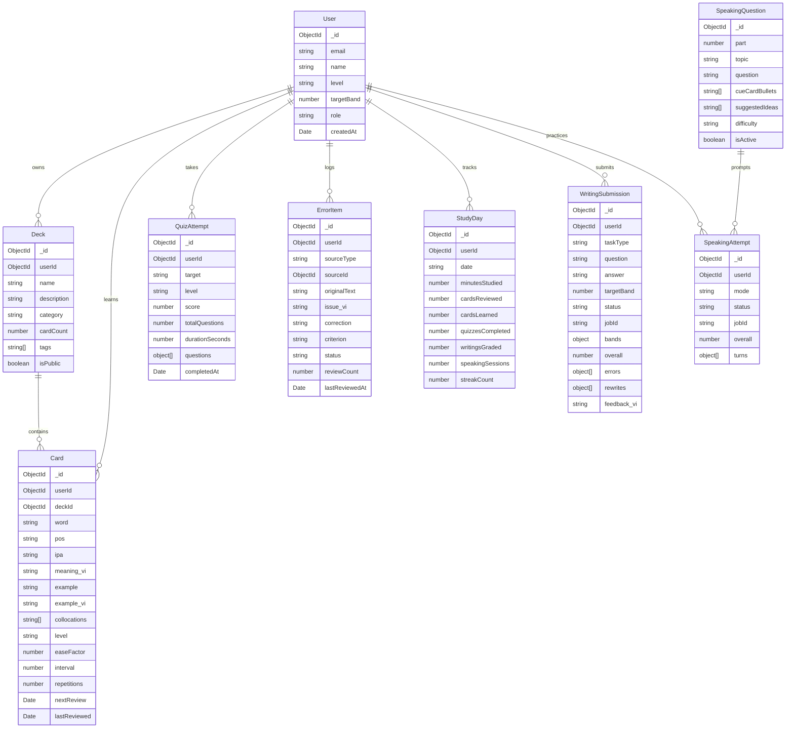

# Domain: database-design

Tài liệu thiết kế toàn diện cho cơ sở dữ liệu MongoDB của dự án **Coflish (IELTS Study Web)**, tuân thủ các quy chuẩn tại `AGENTS.md` và skill `managing-mongodb-data`.

---

## 1. Kiến Trúc Tổng Quan & Nguyên Tắc Thiết Kế

1. **Multi-tenancy Ready**: Mọi collection dữ liệu cá nhân đều có `userId` indexed (`Types.ObjectId`, ref `User`). Giai đoạn MVP sử dụng một Default User ID, sẵn sàng cắm NextAuth mà không cần chạy data migration.
2. **Query Performance & Indexing**:
   - Tất cả các trường dùng cho lọc (`filter`) và sắp xếp (`sort`) đều được đánh index đơn hoặc compound index.
   - Luôn sử dụng `.lean()` trong các truy vấn đọc.
3. **TypeScript Strict & Type Inference**:
   - Schema Mongoose là nguồn sự thật (Single Source of Truth).
   - Export type bằng `InferSchemaType<typeof ...Schema>`, tuyệt đối không dùng `any`.
4. **Tích hợp AI & Xử lý Bất đồng bộ (BullMQ)**:
   - Các tác vụ chấm điểm nặng (>10s) như Writing và Speaking có trường `status: 'pending' | 'processing' | 'completed' | 'failed'` cùng `jobId` để client polling trạng thái.
5. **SRS SM-2 Tương thích**:
   - Collection `Card` cài đặt đầy đủ các thuộc tính toán học của thuật toán Spaced Repetition SM-2 (`easeFactor`, `interval`, `repetitions`, `nextReview`, `lastReviewed`).

---

## 2. Sơ Đồ Thực Thể Quan Hệ (ER Diagram)



---

## 3. Chi Tiết Các Model (Mongoose Schemas & Types)

### 3.1. User Model (`models/User.ts`)
Quản lý thông tin hồ sơ người học, mục tiêu band điểm và trình độ hiện tại.

```ts
import { Schema, model, models, type InferSchemaType } from 'mongoose';

export const UserSchema = new Schema(
  {
    email: { type: String, required: true, unique: true, index: true, lowercase: true, trim: true },
    name: { type: String, required: true, trim: true },
    avatarUrl: { type: String },
    currentLevel: {
      type: String,
      enum: ['A2', 'B1', 'B2', 'C1'],
      default: 'B1',
      required: true,
    },
    targetBand: { type: Number, default: 7.0, min: 4.0, max: 9.0, required: true },
    targetExamDate: { type: Date },
    role: { type: String, enum: ['user', 'admin'], default: 'user', required: true },
  },
  { timestamps: true }
);

export type IUser = InferSchemaType<typeof UserSchema>;
export const UserModel = models.User || model<IUser>('User', UserSchema);
```

---

### 3.2. Deck Model (`models/Deck.ts`)
Bộ sưu tập Flashcard theo chủ đề hoặc tài liệu người học tải lên.

```ts
import { Schema, model, models, type InferSchemaType } from 'mongoose';

export const DeckSchema = new Schema(
  {
    userId: { type: Schema.Types.ObjectId, ref: 'User', required: true, index: true },
    name: { type: String, required: true, trim: true },
    description: { type: String, default: '' },
    category: {
      type: String,
      enum: ['academic', 'topic', 'ocr', 'custom'],
      default: 'custom',
      index: true,
    },
    cardCount: { type: Number, default: 0 },
    tags: [{ type: String, trim: true }],
    isPublic: { type: Boolean, default: false },
  },
  { timestamps: true }
);

DeckSchema.index({ userId: 1, name: 1 });

export type IDeck = InferSchemaType<typeof DeckSchema>;
export const DeckModel = models.Deck || model<IDeck>('Deck', DeckSchema);
```

---

### 3.3. Card Model (`models/Card.ts`)
Từ vựng flashcard với cấu trúc giàu dữ liệu (TTS, AI) và trạng thái Spaced Repetition SM-2.

```ts
import { Schema, model, models, type InferSchemaType } from 'mongoose';

export const CardSchema = new Schema(
  {
    userId: { type: Schema.Types.ObjectId, ref: 'User', required: true, index: true },
    deckId: { type: Schema.Types.ObjectId, ref: 'Deck', required: true, index: true },
    word: { type: String, required: true, trim: true },
    pos: { type: String, trim: true, default: '' }, // part of speech: noun, verb, adj...
    ipa: { type: String, default: '' },
    meaning_vi: { type: String, required: true, trim: true },
    example: { type: String, default: '' },
    example_vi: { type: String, default: '' },
    collocations: [{ type: String, trim: true }],
    level: {
      type: String,
      enum: ['A2', 'B1', 'B2', 'C1'],
      default: 'B1',
    },
    tags: [{ type: String, trim: true }],

    // Spaced Repetition (SM-2 Algorithm)
    easeFactor: { type: Number, default: 2.5, min: 1.3, required: true },
    interval: { type: Number, default: 0, required: true }, // Ngày
    repetitions: { type: Number, default: 0, required: true },
    nextReview: { type: Date, required: true, default: () => new Date(), index: true },
    lastReviewed: { type: Date },
  },
  { timestamps: true }
);

// Compound index tối ưu cho truy vấn ôn tập hàng ngày:
CardSchema.index({ userId: 1, nextReview: 1 });
CardSchema.index({ deckId: 1, nextReview: 1 });
CardSchema.index({ userId: 1, word: 1 });

export type ICard = InferSchemaType<typeof CardSchema>;
export const CardModel = models.Card || model<ICard>('Card', CardSchema);
```

---

### 3.4. ErrorItem Model (`models/ErrorItem.ts`)
Sổ lỗi sai tổng hợp từ các bài tập trắc nghiệm, bài viết Writing và bài nói Speaking.

```ts
import { Schema, model, models, type InferSchemaType } from 'mongoose';

export const ErrorItemSchema = new Schema(
  {
    userId: { type: Schema.Types.ObjectId, ref: 'User', required: true, index: true },
    sourceType: {
      type: String,
      enum: ['quiz', 'writing', 'speaking', 'manual'],
      required: true,
      index: true,
    },
    sourceId: { type: Schema.Types.ObjectId }, // ID của QuizAttempt / WritingSubmission / SpeakingAttempt
    originalText: { type: String, required: true }, // Câu/cụm từ sai
    issue_vi: { type: String, required: true }, // Giải thích lỗi bằng tiếng Việt
    correction: { type: String, required: true }, // Câu sửa đúng
    criterion: {
      type: String,
      required: true,
      index: true,
    },
    status: {
      type: String,
      enum: ['active', 'resolved', 'archived'],
      default: 'active',
      index: true,
    },
    reviewCount: { type: Number, default: 0 },
    lastReviewedAt: { type: Date },
  },
  { timestamps: true }
);

ErrorItemSchema.index({ userId: 1, status: 1, criterion: 1 });

export type IErrorItem = InferSchemaType<typeof ErrorItemSchema>;
export const ErrorItemModel = models.ErrorItem || model<IErrorItem>('ErrorItem', ErrorItemSchema);
```

---

### 3.5. StudyDay Model (`models/StudyDay.ts`)
Bản ghi thống kê từng ngày lịch của người học để hiển thị Heatmap và tính Streak.

```ts
import { Schema, model, models, type InferSchemaType } from 'mongoose';

export const StudyDaySchema = new Schema(
  {
    userId: { type: Schema.Types.ObjectId, ref: 'User', required: true, index: true },
    date: { type: String, required: true }, // Định dạng 'YYYY-MM-DD' theo UTC
    minutesStudied: { type: Number, default: 0 },
    cardsReviewed: { type: Number, default: 0 },
    cardsLearned: { type: Number, default: 0 },
    quizzesCompleted: { type: Number, default: 0 },
    writingsGraded: { type: Number, default: 0 },
    speakingSessions: { type: Number, default: 0 },
    streakCount: { type: Number, default: 1 },
  },
  { timestamps: true }
);

// Đảm bảo 1 user chỉ có 1 bản ghi duy nhất cho mỗi ngày:
StudyDaySchema.index({ userId: 1, date: 1 }, { unique: true });

export type IStudyDay = InferSchemaType<typeof StudyDaySchema>;
export const StudyDayModel = models.StudyDay || model<IStudyDay>('StudyDay', StudyDaySchema);
```

---

### 3.6. QuizAttempt Model (`models/QuizAttempt.ts`)
Lịch sử làm bài trắc nghiệm do AI sinh động từ tài liệu hoặc sổ lỗi sai.

```ts
import { Schema, model, models, type InferSchemaType } from 'mongoose';

const QuizQuestionSnapshotSchema = new Schema(
  {
    id: { type: String, required: true },
    type: { type: String, enum: ['mcq', 'flashcard'], required: true },
    question: { type: String, required: true },
    options: [{ type: String }],
    correctAnswer: { type: Number, required: true }, // Index của option đúng (0..3)
    userAnswer: { type: Number, default: null },
    isCorrect: { type: Boolean, default: false },
    explanation_vi: { type: String, required: true },
    tag: { type: String, default: '' },
  },
  { _id: false }
);

export const QuizAttemptSchema = new Schema(
  {
    userId: { type: Schema.Types.ObjectId, ref: 'User', required: true, index: true },
    target: { type: String, enum: ['vocab', 'grammar', 'mixed'], required: true, index: true },
    level: { type: String, enum: ['A2', 'B1', 'B2'], required: true },
    sourceType: { type: String, enum: ['document', 'error_notebook', 'topic'], default: 'document' },
    sourceSnippet: { type: String, default: '' }, // Đoạn trích văn bản nguồn (tối đa 200 ký tự)
    questions: [QuizQuestionSnapshotSchema],
    score: { type: Number, required: true }, // Số câu đúng
    totalQuestions: { type: Number, required: true },
    durationSeconds: { type: Number, default: 0 },
    completedAt: { type: Date, default: () => new Date(), index: true },
  },
  { timestamps: true }
);

QuizAttemptSchema.index({ userId: 1, completedAt: -1 });

export type IQuizAttempt = InferSchemaType<typeof QuizAttemptSchema>;
export const QuizAttemptModel = models.QuizAttempt || model<IQuizAttempt>('QuizAttempt', QuizAttemptSchema);
```

---

### 3.7. WritingSubmission Model (`models/WritingSubmission.ts`)
Bài viết Writing nộp chấm qua BullMQ và kết quả 4 tiêu chí band descriptors từ AI.

```ts
import { Schema, model, models, type InferSchemaType } from 'mongoose';

const WritingErrorSchema = new Schema(
  {
    sentence: { type: String, required: true },
    issue_vi: { type: String, required: true },
    correction: { type: String, required: true },
    criterion: { type: String, required: true },
  },
  { _id: false }
);

const WritingRewriteSchema = new Schema(
  {
    original: { type: String, required: true },
    better: { type: String, required: true },
    why_vi: { type: String, required: true },
  },
  { _id: false }
);

export const WritingSubmissionSchema = new Schema(
  {
    userId: { type: Schema.Types.ObjectId, ref: 'User', required: true, index: true },
    taskType: { type: String, enum: ['task1', 'task2'], required: true, index: true },
    question: { type: String, required: true },
    answer: { type: String, required: true },
    wordCount: { type: Number, required: true },
    targetBand: { type: Number, required: true },

    // Queue & Processing State
    status: {
      type: String,
      enum: ['pending', 'processing', 'completed', 'failed'],
      default: 'pending',
      index: true,
    },
    jobId: { type: String, index: true },
    errorMessage: { type: String },

    // Grading Result (Validated against zod schema)
    bands: {
      task_achievement: { type: Number },
      coherence_cohesion: { type: Number },
      lexical_resource: { type: Number },
      grammatical_range: { type: Number },
    },
    overall: { type: Number, index: true },
    errors: [WritingErrorSchema],
    rewrites: [WritingRewriteSchema],
    feedback_vi: { type: String },
    completedAt: { type: Date },
  },
  { timestamps: true }
);

WritingSubmissionSchema.index({ userId: 1, createdAt: -1 });

export type IWritingSubmission = InferSchemaType<typeof WritingSubmissionSchema>;
export const WritingSubmissionModel = models.WritingSubmission || model<IWritingSubmission>('WritingSubmission', WritingSubmissionSchema);
```

---

### 3.8. SpeakingQuestion Model (`models/SpeakingQuestion.ts`)
Ngân hàng câu hỏi Speaking theo Part và Topic được seed sẵn (`lib/db/seed/`).

```ts
import { Schema, model, models, type InferSchemaType } from 'mongoose';

export const SpeakingQuestionSchema = new Schema(
  {
    part: { type: Number, enum: [1, 2, 3], required: true, index: true },
    topic: { type: String, required: true, index: true },
    question: { type: String, required: true },
    cueCardBullets: [{ type: String }], // Dành cho Part 2
    suggestedIdeas: [{ type: String }], // Gợi ý từ vựng / dàn ý hỗ trợ học viên
    difficulty: { type: String, enum: ['easy', 'medium', 'hard'], default: 'medium' },
    isActive: { type: Boolean, default: true, index: true },
  },
  { timestamps: true }
);

SpeakingQuestionSchema.index({ part: 1, topic: 1 });

export type ISpeakingQuestion = InferSchemaType<typeof SpeakingQuestionSchema>;
export const SpeakingQuestionModel = models.SpeakingQuestion || model<ISpeakingQuestion>('SpeakingQuestion', SpeakingQuestionSchema);
```

---

### 3.9. SpeakingAttempt Model (`models/SpeakingAttempt.ts`)
Lịch sử buổi luyện nói Speaking (hỗ trợ cả bài đơn lẫn bài thi thử đầy đủ 3 Part).

```ts
import { Schema, model, models, type InferSchemaType } from 'mongoose';

const SpeakingIssueSchema = new Schema(
  {
    quote: { type: String, required: true },
    issue_vi: { type: String, required: true },
    correction: { type: String, required: true },
    criterion: { type: String, required: true },
  },
  { _id: false }
);

const SpeakingTurnSchema = new Schema(
  {
    part: { type: Number, enum: [1, 2, 3], required: true },
    questionId: { type: Schema.Types.ObjectId, ref: 'SpeakingQuestion' },
    question: { type: String, required: true },
    transcript: { type: String, required: true },
    transcript_fixed: { type: String },
    audioSeconds: { type: Number, required: true },
    bands: {
      fluency_coherence: { type: Number },
      lexical_resource: { type: Number },
      grammatical_range: { type: Number },
      pronunciation: { type: Number },
    },
    issues: [SpeakingIssueSchema],
    better_answer_vi: { type: String },
    feedback_vi: { type: String },
  },
  { _id: false }
);

export const SpeakingAttemptSchema = new Schema(
  {
    userId: { type: Schema.Types.ObjectId, ref: 'User', required: true, index: true },
    mode: { type: String, enum: ['full_mock', 'single'], required: true, index: true },
    status: {
      type: String,
      enum: ['pending', 'processing', 'completed', 'failed'],
      default: 'pending',
      index: true,
    },
    jobId: { type: String, index: true },
    errorMessage: { type: String },
    turns: [SpeakingTurnSchema],
    overall: { type: Number, index: true },
    completedAt: { type: Date },
  },
  { timestamps: true }
);

SpeakingAttemptSchema.index({ userId: 1, createdAt: -1 });

export type ISpeakingAttempt = InferSchemaType<typeof SpeakingAttemptSchema>;
export const SpeakingAttemptModel = models.SpeakingAttempt || model<ISpeakingAttempt>('SpeakingAttempt', SpeakingAttemptSchema);
```

---

## 4. Bảng Chỉ Mục (Index Matrix)

| Model | Index Spec | Mục đích |
| :--- | :--- | :--- |
| `User` | `{ email: 1 }` (unique) | Tra cứu định danh duy nhất |
| `Deck` | `{ userId: 1, name: 1 }`, `{ category: 1 }` | Danh sách bộ từ của học viên |
| `Card` | `{ userId: 1, nextReview: 1 }`, `{ deckId: 1, nextReview: 1 }` | Truy vấn học từ đến hạn theo thuật toán SM-2 |
| `ErrorItem` | `{ userId: 1, status: 1, criterion: 1 }` | Lọc sổ lỗi sai để sinh quiz khắc phục |
| `StudyDay` | `{ userId: 1, date: 1 }` (unique) | Tính streak và vẽ biểu đồ đóng góp theo ngày |
| `QuizAttempt` | `{ userId: 1, completedAt: -1 }` | Lịch sử làm bài trắc nghiệm |
| `WritingSubmission` | `{ userId: 1, createdAt: -1 }`, `{ status: 1 }` | Lịch sử bài viết & polling BullMQ |
| `SpeakingAttempt` | `{ userId: 1, createdAt: -1 }`, `{ status: 1 }` | Lịch sử bài nói & polling BullMQ |
| `SpeakingQuestion` | `{ part: 1, topic: 1 }`, `{ isActive: 1 }` | Kho câu hỏi thi thử theo chủ đề |
